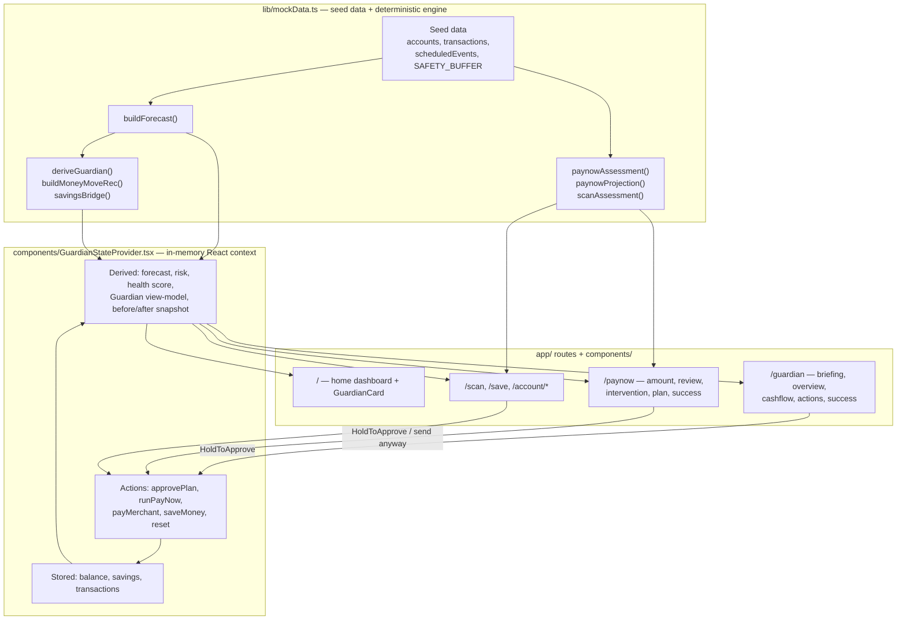

# Financial Guardian

**Catch cash-flow problems before they happen — a proactive banking companion that forecasts the next 30 days, flags risky payments before they are sent, and leaves every decision with the customer.**

Built by **Team NeuroStack** for the **PolyFinTech Hackathon 2026**.


**Live demo:** [ocbc-financial-guardian.vercel.app](https://ocbc-financial-guardian.vercel.app)

> Independent hackathon prototype using illustrative data. Not an official OCBC product. See the [disclaimer](#disclaimer).

---

## Contents

- [Overview](#overview)
- [Problem statement](#problem-statement)
- [Our solution](#our-solution)
- [Key features](#key-features)
- [How it works](#how-it-works)
- [Architecture and technical implementation](#architecture-and-technical-implementation)
- [Technology stack](#technology-stack)
- [Getting started](#getting-started)
- [Example user journey](#example-user-journey)
- [Screenshots and demonstration](#screenshots-and-demonstration)
- [Current limitations](#current-limitations)
- [Future implementation roadmap](#future-implementation-roadmap)
- [Success metrics](#success-metrics)
- [Team and acknowledgements](#team-and-acknowledgements)
- [Disclaimer](#disclaimer)

---

## Overview

Financial Guardian is a mobile banking prototype that looks *forward* rather than backward. Starting from a customer's current balance and their known upcoming bills, subscriptions and salary, it projects the spending account's balance over the next 30 days, finds the lowest point before payday, and warns the customer if that point falls below a safety cushion they want to keep. It then suggests concrete fixes — such as moving a specific amount from savings — explains how each figure was derived, and only carries out a (simulated) action after the customer explicitly approves it. The same forward check runs at the moment of payment: before a large PayNow transfer is sent, the customer sees what it would do to their balance before payday and can choose how to proceed.

The prototype is presented inside a simulated, OCBC-style mobile banking app to show how the concept could sit within an existing banking experience.

## Problem statement

Most banking apps are built around **what has already happened**: the current balance and a list of past transactions. That is useful, but it leaves the customer to work out what happens next.

- **Balances don't show commitments.** A healthy balance today can hide a rent payment, insurance premium or deposit that is due before the next salary credit. The customer has to mentally subtract those commitments to know what is actually safe to spend.
- **Shortfalls come from timing, not just overspending.** A customer can earn enough over the month and still run short for a few days if large outgoings land before payday.
- **The risky moment is the payment itself.** By the time a transaction appears in history, the decision has been made. A prompt *before* confirming a payment — "this would leave you below your cushion on day 9" — is far more useful than a low-balance alert afterwards.
- **Customer-centric banking means helping, not deciding.** Any proactive guidance has to be explainable and has to leave the customer in control of their own money.

This challenge sits squarely within proactive, customer-centric banking: using information a bank already holds about scheduled payments and income patterns to help customers avoid avoidable stress.

## Our solution

Financial Guardian shifts the experience from **reactive reporting** to **proactive guidance** in four steps:

1. **Forecast** — Replay known upcoming debits and credits against the live balance to produce a day-by-day projection to month end.
2. **Assess** — Find the lowest projected balance before salary day and compare it with the customer's safety cushion (SGD 500 in the demo). For a proposed payment, simulate the position *after* the payment and grade the outcome.
3. **Recommend** — Prepare specific actions (e.g. "move SGD 700 from savings"), each with the current situation, the expected before/after result, and a plain-language "why" that shows how the amount was calculated. Recommendations never propose moving more than the savings balance actually holds.
4. **Defer to the customer** — Nothing moves without a deliberate press-and-hold approval. The customer can also ignore the advice and proceed anyway; Guardian never blocks a payment.

## Key features

All features below are implemented in the prototype and operate on simulated data.

| # | Feature | Where it lives |
|---|---------|----------------|
| 1 | **30-day cash-flow forecast** — balance projection rebuilt from the live balance and scheduled events, shown as a chart and a dated timeline. | `buildForecast()` in `lib/mockData.ts`; `/guardian/cashflow`, `components/CashflowChart.tsx` |
| 2 | **Lowest-balance and shortfall detection** — the lowest point before salary day is flagged and compared with the SGD 500 cushion; risk is Low / Medium / High depending on whether it breaches the cushion or goes negative. | `buildForecast()`, `deriveGuardian()` |
| 3 | **Personalised recommendations with explanations** — a money-move recommendation sized from the forecast plus two behavioural suggestions, each with before/after, "if ignored" and "Why am I seeing this?" content. | `buildMoneyMoveRec()`, `/guardian/actions`, `components/RecommendationBody.tsx`, `components/WhyThis.tsx` |
| 4 | **PayNow pre-transaction risk assessment** — before final confirmation, the transfer is graded into one of five tiers (`clear`, `steady`, `protect`, `drawdown`, `shortfall`); the higher tiers trigger an intervention sheet showing the reasoning, with options to see a plan, change the amount or send anyway. | `paynowAssessment()`, `/paynow` |
| 5 | **Savings top-up suggestions capped to available funds** — top-ups are rounded to SGD 100 and limited to the simulated savings balance; when savings cannot cover the gap, the copy says so. | `savingsBridge()`, `paynowProjection()`, `/paynow/plan` |
| 6 | **Explicit approval before simulated actions** — a press-and-hold control is required before any simulated money movement. | `components/HoldToApprove.tsx` |
| 7 | **Forecast-aware Scan & Pay and Save flows** — a mock QR merchant payment and a move-to-savings flow both show a non-blocking note based on the projected position after the action. | `scanAssessment()`, `/scan`, `/save` |
| 8 | **Account activity ledgers** — spending and savings ledgers that gain new rows for every simulated transfer, payment or top-up. | `components/AccountActivity.tsx`, `/account/frank`, `/account/savings` |
| 9 | **Before-and-after outcomes** — success screens compare health score, risk level, lowest balance and month-end projection before and after the action. | `/guardian/success`, `/paynow/success`, `/scan/success`, `/save/success` |
| 10 | **Session-level state that compounds** — every action updates the in-memory balances, so later forecasts and assessments reflect earlier actions (e.g. the same SGD 800 PayNow needs a smaller top-up after a previous savings transfer). | `components/GuardianStateProvider.tsx` |

## How it works

```
Account balances + scheduled events (bills, subscriptions, salary)
        │
        ▼
Cash-flow forecast         buildForecast(balance)
        │                  → day-by-day points, lowest balance before payday, month-end
        ▼
Risk assessment            deriveGuardian(...) / paynowAssessment(...) / scanAssessment(...)
        │                  → status, risk level, intervention tier
        ▼
Recommendation generation  buildMoneyMoveRec(...), savingsBridge(...), paynowProjection(...)
        │                  → amounts, before/after figures, explanations
        ▼
Customer review & approval Action Centre / PayNow plan → press-and-hold to approve
        │
        ▼
Simulated execution        approvePlan / runPayNow / payMerchant / saveMoney
        │                  → update in-memory balance, savings and transactions
        ▼
Updated balances, forecast, risk and ledgers (all re-derived automatically)
```

**The decision engine is deterministic.** Every number is computed by plain TypeScript functions from a small set of inputs: the spending balance, the savings balance and a fixed list of scheduled events. The same inputs always produce the same outputs. The "Guardian is thinking…" and "carrying out your plan…" sequences (`components/GuardianSequence.tsx`) are timed presentation animations that step through fixed labels; they do not represent live model inference.

A few worked numbers from the seed data:

- Starting balance SGD 2,300 → after Spotify, ChatGPT, groceries, insurance and a SGD 1,400 rental deposit, the forecast bottoms out at **SGD 484.20 on day 9**, just under the SGD 500 cushion, before a SGD 4,500 salary on day 10.
- The Journey A top-up targets the cushion plus about one week of typical spending (SGD 500 + SGD 605), rounded up to SGD 100 → **SGD 700 from savings**.
- A SGD 800 PayNow would push the low to **−SGD 315.80**; the plan tops up **SGD 900** (rounded to clear the cushion, within the SGD 1,200 savings balance), lifting the low to **SGD 584.20** and risk from Medium to Low.

## Architecture and technical implementation

The app is a client-side Next.js (App Router) application. There is no API layer: every screen reads from one React context, which derives everything from two stored numbers.



### Key modules

| File | Responsibility |
|------|----------------|
| `lib/mockData.ts` | Seed data (customer, accounts, transactions, scheduled events, PayNow and Scan scenarios) and the deterministic engine: `buildForecast`, `deriveHealthScore`, `deriveGuardian`, `buildMoneyMoveRec`, `combinedRiskReduction`, `planConfidence`, `savingsBridge`, `paynowProjection`, `paynowAssessment`, `scanAssessment`. |
| `components/GuardianStateProvider.tsx` | Session-scoped store built on React context and `useState`. Stores only `balance`, `savings` and `transactions`; recomputes forecast, risk, health score and the Guardian view-model with `useMemo`; exposes the simulated actions and captures a "before" snapshot for before/after comparisons. |
| `app/layout.tsx` | Wraps every route in `GuardianStateProvider` and `PhoneFrame`. |
| `app/page.tsx` | Simulated banking home screen with live balances and the Guardian card. |
| `app/guardian/*` | Daily briefing (`page.tsx`), full analysis (`overview`), 30-day forecast (`cashflow`), selectable recommendations (`actions`) and plan outcome (`success`). |
| `app/paynow/*` | PayNow amount entry and review with the pre-transaction assessment and intervention sheet (`page.tsx`), the savings-bridge plan (`plan`) and the outcome (`success`). |
| `app/scan/*`, `app/save/*` | Mock QR Scan & Pay and move-to-savings flows with forecast-aware notes. |
| `app/account/frank`, `app/account/savings` | Account activity ledgers rendered by `components/AccountActivity.tsx`. |
| `components/GuardianCard.tsx` | Home-screen card with alert, healthy and post-approval states. |
| `components/CashflowChart.tsx` | SVG chart of the projected balance against the safety cushion. |
| `components/HoldToApprove.tsx` | Press-and-hold consent control built on pointer events. |
| `components/GuardianSequence.tsx` | Skippable "thinking" and "execution" presentation animations. |
| `components/RecommendationBody.tsx`, `WhyThis.tsx`, `HealthScoreRing.tsx`, `LearningNote.tsx` | Recommendation detail, explanations, score ring and post-action note. |
| `components/PhoneFrame.tsx`, `AppHeader.tsx`, `BottomNav.tsx`, `Keypad.tsx`, `FakeQR.tsx`, … | Mobile-frame shell and shared UI primitives. |

### Design decisions

- **Single source of truth.** Only the balances and transaction list are stored. Forecast, risk, recommendations and copy are derived on every render, so screens cannot drift out of sync after an action.
- **Outcome-based assessment, not amount thresholds.** `paynowAssessment` grades where the customer *ends up* (lowest balance before payday, balance left today, share of savings needed to restore the cushion) rather than flagging payments above a fixed size.
- **Hard safety rails in the engine.** Top-ups are capped at the savings balance, and the Save flow cannot move more than the spending balance.
- **Never blocking.** Every intervention offers a way to proceed without the plan.

## Technology stack

Versions are those declared in `package.json` and resolved in `package-lock.json`.

| Area | Technology |
|------|------------|
| Framework | [Next.js](https://nextjs.org/) 14.2 (App Router) |
| UI library | [React](https://react.dev/) 18.3 |
| Language | [TypeScript](https://www.typescriptlang.org/) 5 (strict mode) |
| Styling | [Tailwind CSS](https://tailwindcss.com/) 3.4, PostCSS, Autoprefixer |
| Animation | [Framer Motion](https://www.framer.com/motion/) 11 |
| Icons | [lucide-react](https://lucide.dev/) 0.417 |
| Deployment | [Vercel](https://vercel.com/); optional Docker image (`Dockerfile`, `docker-compose.yml`) using Next.js standalone output |

## Getting started

### Prerequisites

- [Node.js](https://nodejs.org/) 18.17 or later (Node 20 LTS recommended; the Docker image uses `node:20-alpine`)
- npm (the repository ships a `package-lock.json`)

No environment variables, API keys or external services are required.

### Install and run

```bash
git clone https://github.com/kwek-na-yi/polyfintech-2026-ocbc-financial-guardian.git
cd polyfintech-2026-ocbc-financial-guardian
npm install
npm run dev
```

Open [http://localhost:3000](http://localhost:3000). The UI is designed for a phone-sized viewport and is rendered inside a phone frame on larger screens.

### Production build

```bash
npm run build
npm start
```

### Docker (optional)

```bash
docker compose up --build
```

Then open [http://localhost:3000](http://localhost:3000).

### Resetting the demo

All state lives in memory. A hard refresh of the browser restores the seed balances (spending SGD 2,300, savings SGD 1,200).

## Example user journey

The demo follows a fictional customer, Jia Hui, mid-month with payday ten days away. **All names, balances and transactions are illustrative demo values, not real customer data.**

1. **Open the home screen** (`/`). Balances show SGD 2,300 in the spending account and SGD 1,200 in savings. The Guardian card warns that money could run low in about 9 days.
2. **Review the Guardian briefing** (`/guardian`). After a short "thinking" animation, the briefing summarises what was noticed: the dip below the cushion, the upcoming salary, an unusual-spending signal and a possible home move.
3. **Check the forecast** (`/guardian/cashflow`). The 30-day chart and timeline show the balance falling to SGD 484.20 on day 9 after a SGD 1,400 rental deposit, then recovering on salary day.
4. **Explore the recommendations** (`/guardian/actions`). Each recommendation shows its before/after effect and reasoning; toggling them updates the combined risk-reduction ring. These can be viewed without approving.
5. **Start an S$800 PayNow transfer** (`/paynow`) to a fictional friend for a weekend trip, then tap *Transfer Now*.
6. **Review the projected impact.** Before anything is sent, the intervention sheet shows the lowest balance would fall from SGD 484 to −SGD 316.
7. **Consider the suggested plan** (`/paynow/plan`): send the full SGD 800, top up SGD 900 from savings, and keep the lowest point at SGD 584, above the cushion.
8. **Explicitly approve** by pressing and holding *Hold to send*.
9. **Review the outcome** (`/paynow/success`, then `/account/frank`): risk drops from Medium to Low, savings fall to SGD 300, and both the top-up and the PayNow transfer appear in the account activity ledger.

## Screenshots and demonstration

The live prototype is available at **[ocbc-financial-guardian.vercel.app](https://ocbc-financial-guardian.vercel.app)**.

Screenshots have not yet been added to the repository. The planned set, to be stored in `docs/screenshots/`, is:

| Screen | Route |
|--------|-------|
| Home screen with Guardian alert | `/` |
| Guardian briefing | `/guardian` |
| 30-day cash-flow forecast | `/guardian/cashflow` |
| Recommendations / Action Centre | `/guardian/actions` |
| PayNow intervention | `/paynow` (after *Transfer Now* with SGD 800) |
| Transaction outcome | `/paynow/success` |

## Current limitations

This is a hackathon prototype. In particular:

- **Illustrative, hardcoded data.** Accounts, transactions, the seven scheduled events, the salary amount and the SGD 500 cushion are constants in `lib/mockData.ts`. Spending between scheduled events is modelled as a single fixed month-end adjustment, and the briefing date is fixed.
- **Deterministic rules, not AI/ML.** There is no trained model, LLM, RAG pipeline or external AI API. Confidence figures (e.g. plan confidence, the "87% sure" home-move signal) and the risk-reduction percentages for behavioural recommendations are formula-based or fixed illustrative values, not calibrated probabilities.
- **No learning.** The post-action "learning" notes are presentational copy; no customer preferences are stored or used to change future behaviour.
- **No live OCBC or banking integration.** No real accounts are read and no PayNow, FAST or ledger APIs are called. The QR code is decorative and not scannable.
- **No backend, database or persistent profile.** State is held in React memory and resets on a hard refresh; it is not shared between devices or sessions.
- **Simulated financial actions.** Transfers, payments and savings moves only update in-memory numbers.
- **No production security infrastructure.** There is no authentication, authorisation, consent management, transaction signing or banking-grade audit logging.
- **Single scenario.** The engine supports one customer profile and one PayNow recipient.
- **No automated tests or lint configuration** are currently included; verification has been manual plus TypeScript strict type-checking and the Next.js production build.

## Future implementation roadmap

The following is **proposed future work**. None of it is implemented in this repository, and timelines, approvals and outcomes are not guaranteed.

**Phase 1 — Data and infrastructure**
- Secure backend service and database.
- Customer authentication and consent management for data use.
- Persistent customer profiles, preferences (e.g. personal cushion) and transaction history.
- Integration with approved banking data sources through sanctioned interfaces.

**Phase 2 — Forecasting and intelligence**
- Forecasting models trained and validated on appropriate historical data, covering recurring and irregular spending.
- Anomaly detection and calibrated confidence estimates.
- Explainable risk assessments, with recommendation quality evaluated offline.
- Benchmarking against simple baselines (such as the current rule-based engine) and testing on edge cases.

**Phase 3 — Responsible agentic capabilities**
- Context-aware recommendations with tightly scoped tool access.
- Explicit permission boundaries and approval workflows for any money movement.
- Audit trails, monitoring, safe fallbacks and rollback procedures.
- Adversarial testing and ongoing human oversight.

**Phase 4 — Controlled pilot**
- Security assessment and privacy review.
- Assessment against relevant regulatory and compliance requirements.
- Internal testing followed by a limited, opt-in pilot.
- Measurement against the success metrics below.

## Success metrics

These are **proposed** criteria for evaluating a future pilot. They are not measured results.

| Area | Proposed metric |
|------|-----------------|
| Forecast quality | Error between projected and actual lowest balance and month-end balance (e.g. mean absolute error) |
| Alert quality | False-positive rate (alerts where no shortfall would have occurred) and false-negative rate (missed shortfalls) |
| Engagement | Share of customers who open, review and act on recommendations |
| Outcomes | Frequency of avoidable shortfalls versus a control group in an appropriately designed evaluation |
| Comprehension and trust | Survey-based understanding of why a recommendation was made, and stated trust in the guidance |
| Intervention response | Acceptance, modification, "send anyway" and opt-out rates for pre-payment interventions |

## Team and acknowledgements

Developed by **Team NeuroStack** for the **PolyFinTech Hackathon 2026**.

Thanks to the PolyFinTech Hackathon 2026 organisers, mentors and judges.

## Disclaimer

Financial Guardian is an independent educational and hackathon prototype built with illustrative data. It is **not an official OCBC product** and is not affiliated with, endorsed by or connected to OCBC Bank. It does not access real bank accounts, does not move real money, and must not be used to make real financial decisions. Names of banks, products and merchants appear only to make the simulated scenario realistic; all trademarks belong to their respective owners.
