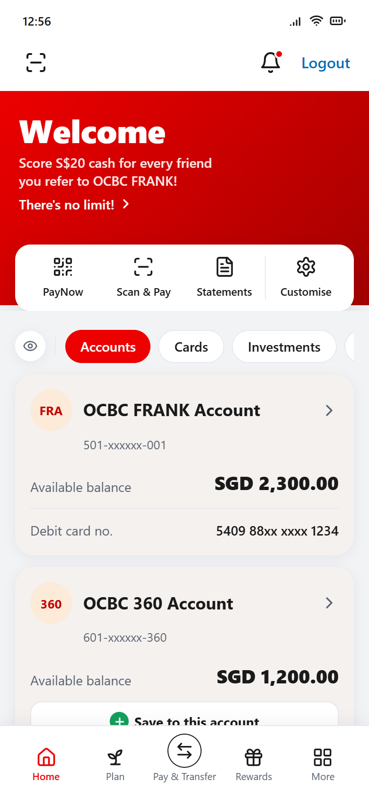
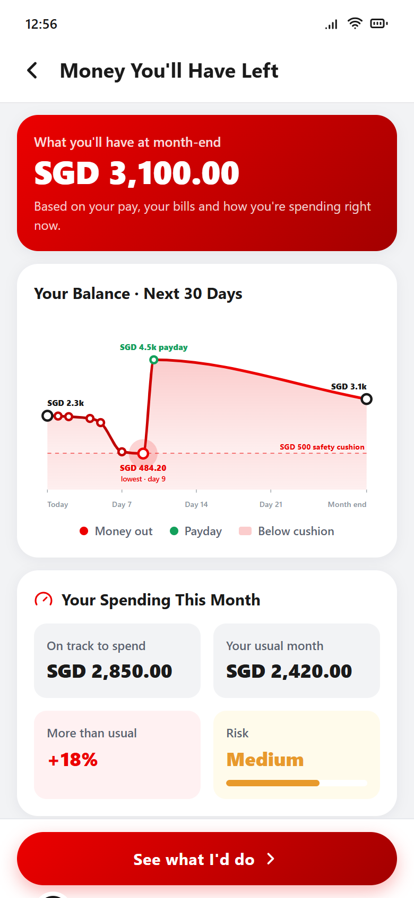
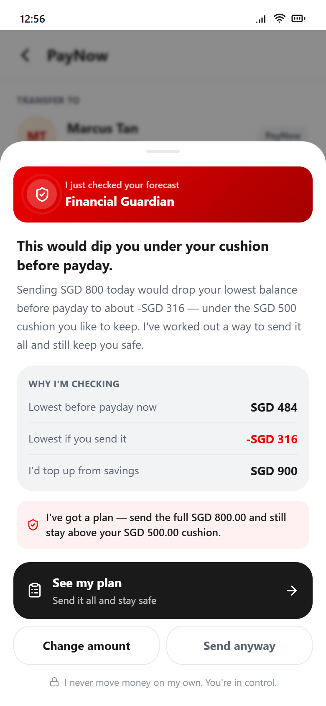
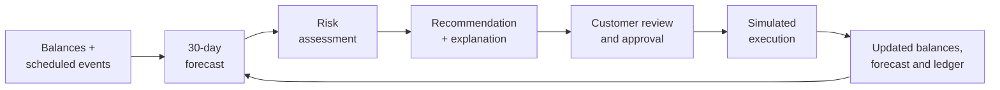
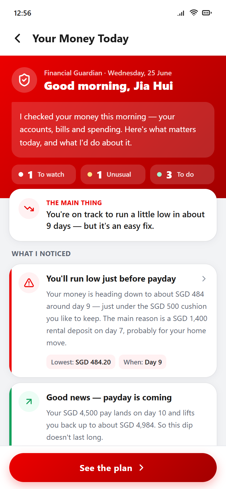
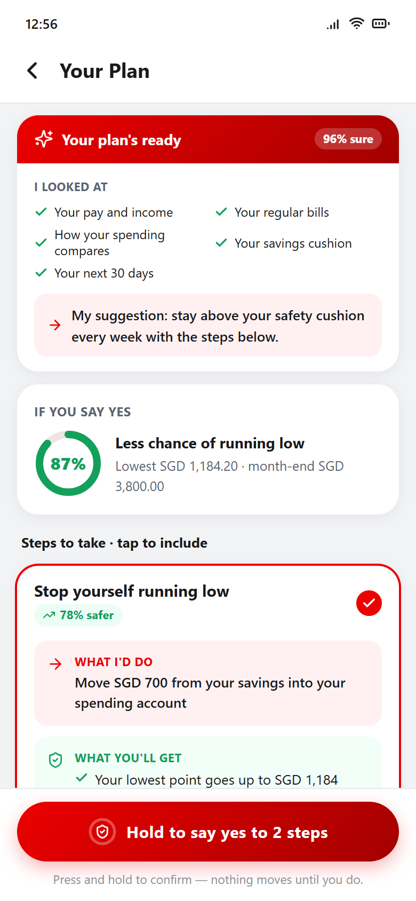
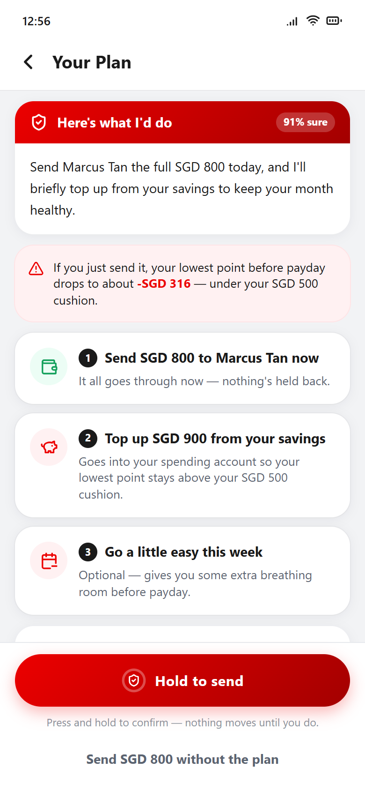
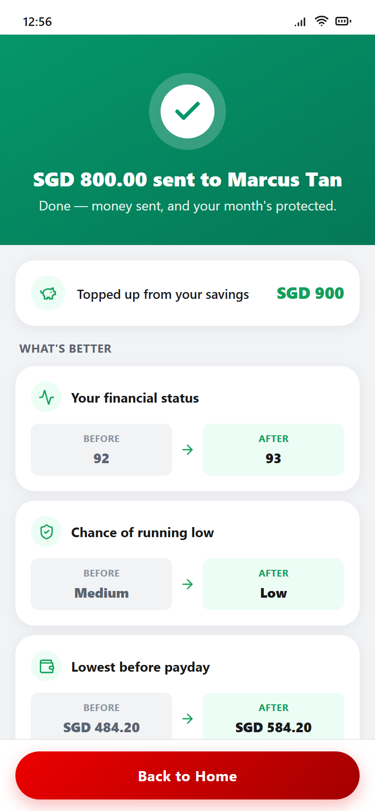
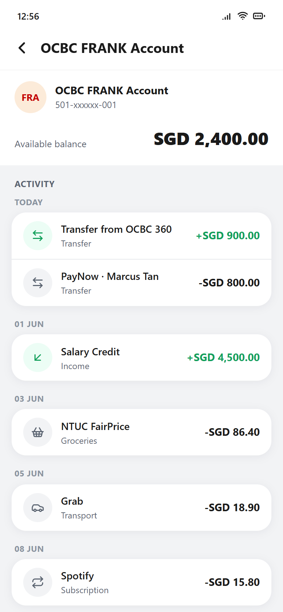

# Financial Guardian

A proactive banking prototype that forecasts a customer's next 30 days, flags cash-flow risks before a payment is made, and leaves every decision with the customer.

Built by **Team NeuroStack** for the **PolyFinTech Hackathon 2026**.

**Live demo:** [ocbc-financial-guardian.vercel.app](https://ocbc-financial-guardian.vercel.app) · best viewed at phone width

<p align="center">
  
  &nbsp;
  
  &nbsp;
  
</p>

> Independent hackathon prototype using illustrative data. Not an official OCBC product. See the [disclaimer](#disclaimer).

## Overview

Most banking apps show what has already happened: the current balance and past transactions. Financial Guardian looks ahead instead. It replays a customer's known upcoming bills, subscriptions and salary against their live balance, finds the lowest point before payday, and warns them if that point falls below a safety cushion they want to keep. It then suggests specific fixes, explains how each figure was calculated, and carries out a (simulated) action only after the customer explicitly approves it.

The same check runs at the moment of payment: before a large PayNow transfer is sent, the customer sees what it would do to their balance before payday and chooses how to proceed. The prototype is presented inside a simulated, OCBC-style mobile banking app to show how the idea could sit within an existing banking experience.

## Problem statement

- **Balances hide commitments.** A healthy balance today can conceal rent, insurance or a deposit due before the next salary. Customers have to subtract these in their heads to know what is actually safe to spend.
- **Shortfalls are often about timing.** A customer can earn enough over the month and still run short for a few days if large outgoings land before payday.
- **The payment is the decision point.** Once a transfer appears in the transaction history, the money has already gone. A prompt *before* confirming a payment is more useful than a low-balance alert afterwards.
- **Guidance must keep the customer in control.** Proactive help is only trustworthy if it explains itself and never acts on the customer's behalf without consent.

This makes the challenge a good fit for proactive, customer-centric banking: using information a bank already holds about scheduled payments and income to help customers avoid preventable cash-flow stress.

## Our solution

Financial Guardian moves the experience from reactive reporting to proactive guidance:

1. **Forecast:** project the spending account day by day to month end from the live balance and scheduled events.
2. **Assess:** compare the lowest balance before payday with the customer's cushion (SGD 500 in the demo). For a proposed payment, simulate the position *after* the payment and grade the outcome.
3. **Recommend:** propose specific actions (e.g. "move SGD 700 from savings") with before/after figures and a plain-language explanation of how the amount was chosen. Recommendations never exceed the savings balance actually available.
4. **Defer to the customer:** nothing moves without a deliberate press-and-hold approval, and every intervention offers a way to proceed without the plan.

### Intended value

These are hypotheses that a pilot would need to test, not demonstrated results:

- **For customers:** earlier warning of short-term shortfalls, clearer understanding of upcoming commitments, and practical options at the moment of decision.
- **For the bank:** a more useful, engagement-driving digital experience, and potentially fewer customer shortfalls and the support contacts that follow them.

## Key features

Everything below is implemented in the prototype and runs on simulated data.

| Feature | What it does |
|---------|--------------|
| **30-day cash-flow forecast** | Rebuilds a day-by-day projection from the live balance and scheduled events, shown as a chart and a dated timeline. |
| **Shortfall detection** | Flags the lowest balance before payday and rates risk Low, Medium or High depending on whether it breaches the cushion or goes negative. |
| **Explainable recommendations** | Sizes a savings top-up from the forecast and adds two behavioural suggestions, each with before/after, "if ignored" and "Why am I seeing this?" detail. |
| **PayNow pre-transaction check** | Grades a transfer before confirmation into one of five outcome tiers; higher-risk tiers open an intervention sheet showing the reasoning, with *See my plan*, *Change amount* and *Send anyway* options. |
| **Savings top-ups capped to real funds** | Rounds top-ups to SGD 100 and limits them to the simulated savings balance; when savings can't close the gap, the copy says so. |
| **Explicit approval** | Requires a press-and-hold gesture before any simulated money movement. |
| **Forecast-aware Scan & Pay and Save** | Shows a non-blocking note on a mock QR payment or a move to savings, based on the projected position afterwards. |
| **Account activity ledgers** | Adds a ledger row for every simulated transfer, payment or top-up, on both accounts. |
| **Before-and-after outcomes** | Success screens compare status score, risk level, lowest balance and month-end projection. |
| **Session state that compounds** | Every action updates in-memory balances, so later forecasts and assessments reflect earlier actions. |

## How it works



**The decision engine is deterministic.** Every figure is computed by plain TypeScript functions from three inputs: the spending balance, the savings balance and a fixed list of scheduled events. The same inputs always give the same outputs. The "thinking" and "carrying out your plan" sequences are timed presentation animations, not live model inference.

Worked example with the seed data:

| Step | Value |
|------|-------|
| Starting balance | SGD 2,300 (savings SGD 1,200) |
| Lowest point before payday | **SGD 484.20 on day 9**, after a SGD 1,400 rental deposit and just under the SGD 500 cushion |
| Proposed SGD 800 PayNow | Lowest point would fall to **−SGD 315.80** → intervention shown |
| Suggested plan | Top up **SGD 900** from savings (rounded to clear the cushion, within available funds) |
| Result after approval | Lowest point **SGD 584.20**, risk Medium → Low, savings SGD 300 |

## Architecture and technology stack

A client-side Next.js App Router application with no API layer:

- **`lib/mockData.ts`**: seed data and the decision engine (`buildForecast`, `deriveGuardian`, `paynowAssessment`, `savingsBridge`, `scanAssessment`, …).
- **`components/GuardianStateProvider.tsx`**: a React context that stores only `balance`, `savings` and `transactions` and derives the forecast, risk and recommendations from them on every change, so no screen can drift out of sync.
- **`app/`**: route pages for the home screen, Guardian briefing and forecast, PayNow, Scan & Pay, Save and account activity.
- **`components/`**: shared UI, including the SVG forecast chart and the press-and-hold approval control.
- **Tests** sit next to the code they cover: `lib/mockData.test.ts` and `components/GuardianStateProvider.test.tsx`.

See **[docs/ARCHITECTURE.md](docs/ARCHITECTURE.md)** for the state model, engine formulas, PayNow risk tiers, simulated actions, route map and test coverage.

| Area | Technology |
|------|------------|
| Framework | Next.js 14.2 (App Router), React 18.3 |
| Language | TypeScript 5 (strict mode) |
| Styling | Tailwind CSS 3.4, PostCSS, Autoprefixer |
| Animation and icons | Framer Motion 11, lucide-react |
| Quality | ESLint 8 (`next/core-web-vitals`), Vitest 5, React Testing Library, jsdom |
| Deployment | Vercel; optional Docker image using Next.js standalone output |

## Getting started

**Prerequisites:** Node.js 22.12 or later (current LTS) and npm. Node 22 is required by the test runner; the app itself builds on older Node versions. No environment variables, API keys or external services are required.

```bash
git clone https://github.com/kwek-na-yi/PolyFinTech-2026-OCBC-Financial-Guardian.git
cd PolyFinTech-2026-OCBC-Financial-Guardian
npm install
npm run dev
```

Open [http://localhost:3000](http://localhost:3000). The UI is designed for phone-sized screens and appears inside a phone frame on desktop.

| Task | Command |
|------|---------|
| Development server | `npm run dev` |
| Lint | `npm run lint` |
| Type-check | `npm run typecheck` |
| Tests | `npm test` (or `npm run test:watch`) |
| Production build | `npm run build` |
| Serve the production build | `npm start` (logs a standalone-output warning; the build still serves) |
| Docker | `docker compose up --build`, then open `http://localhost:3000` |

All state is held in memory. Refreshing the page restores the seed data.

### Tests

`npm test` runs 45 unit and integration tests covering the forecast, risk boundaries, recommendation sizing, PayNow risk tiers and every simulated action. They confirm the code does what it is designed to do, not that the forecasts are financially accurate. See [docs/ARCHITECTURE.md § Testing](docs/ARCHITECTURE.md#testing) for details.

### Configuration and deployment

**Environment variables:** none. The app reads no environment variables, locally or in production, and needs no API keys or `.env` file. All environment files are excluded by `.gitignore`.

**Vercel:** the live demo uses Vercel's standard Next.js setup, with no `vercel.json` and no project environment variables. To deploy your own copy, import the repository in the Vercel dashboard (or run the external `vercel` CLI) and keep the defaults: framework preset Next.js, build command `npm run build`. Set the project's Node.js version to 22.x to match local development.

**Docker:** `next.config.js` produces a standalone server build, and the `Dockerfile` packages it into a small, non-root image that serves on port 3000.

## Example user journey

The demo follows a fictional customer, Jia Hui, mid-month with payday ten days away. **All names, balances and transactions are illustrative.**

1. **Home:** balances show SGD 2,300 (spending) and SGD 1,200 (savings).
2. **Guardian briefing:** after a short reasoning animation, Guardian summarises the coming dip below the cushion, the upcoming salary and other signals.
3. **Forecast:** the 30-day chart shows the balance falling to SGD 484.20 on day 9, then recovering on payday.
4. **Recommendations:** each step shows its effect and reasoning; ticking steps updates the combined risk reduction. Nothing happens until the customer holds to approve.
5. **PayNow:** the customer starts an SGD 800 transfer to a friend and taps *Transfer Now*.
6. **Intervention:** before anything is sent, Guardian shows the lowest balance would drop from SGD 484 to −SGD 316.
7. **Plan:** send the full SGD 800 and top up SGD 900 from savings to stay above the cushion.
8. **Approval:** the customer presses and holds *Hold to send*.
9. **Outcome:** risk drops from Medium to Low, and both the top-up and the transfer appear in the account activity.

| Briefing | Recommendations | Plan |
|:---:|:---:|:---:|
|  |  |  |
| **Outcome** | **Account activity** | |
|  |  | |

## Current limitations

- **Illustrative, hardcoded data.** Accounts, transactions, the seven scheduled events, salary and the SGD 500 cushion are constants. Spending between scheduled events is a single fixed month-end adjustment, and the briefing date is fixed.
- **Deterministic rules, not AI/ML.** There is no trained model, LLM, RAG pipeline or external AI API. Confidence figures (such as "96% sure" or the "87% sure" home-move signal) and the behavioural risk-reduction percentages are formula-based or fixed values, not calibrated probabilities.
- **No learning.** Post-action "learning" notes are presentational copy; no preferences are stored or reused.
- **No banking integration.** No real accounts are read and no PayNow or ledger APIs are called. The QR code is decorative.
- **No backend or persistence.** State lives in browser memory and resets on refresh. There are no user accounts.
- **No production security.** There is no authentication, consent management, transaction signing or audit logging.
- **Single scenario.** One customer profile and one PayNow recipient.
- **Limited test coverage.** Unit and integration tests cover the engine and state store; there are no automated UI or end-to-end tests and no CI pipeline yet.
- **Dependency advisories.** `npm audit` reports advisories against Next.js 14 and Tailwind CSS 3 whose fixes require major-version upgrades, which have not been made.

## Future development roadmap

**Proposed future work. None of this is implemented, and no timelines, approvals or outcomes are implied.**

1. **Data and infrastructure:** a secure backend and database; authentication and consent management; persistent profiles, preferences and transaction history; a controlled integration with approved banking data sources, subject to appropriate access and approval.
2. **Forecasting and risk:** forecasting models validated against historical data, including irregular spending; anomaly detection with calibrated confidence; benchmarking against the current rule-based engine; work to reduce false alerts.
3. **Responsible recommendations:** explainable recommendation workflows; tightly scoped permissions and approval steps for any money movement; audit trails, monitoring, fallbacks and rollback procedures; adversarial testing and human oversight.
4. **Quality and pilot:** end-to-end UI tests and continuous integration; an upgrade to current framework versions; security, privacy and regulatory review; internal testing followed by a limited opt-in pilot measured against the metrics below.

## Proposed success metrics

**These are proposed evaluation metrics for a future pilot. They are not measured results.**

| Area | Metric |
|------|--------|
| Forecast accuracy | Error between projected and actual lowest and month-end balances |
| Alert quality | False-positive rate (alerts with no real shortfall) and false-negative rate (missed shortfalls) |
| Recommendation uptake | Share of recommendations reviewed, accepted, modified or dismissed |
| Customer outcomes | Frequency of avoidable shortfalls versus a control group |
| Comprehension and trust | Survey-based understanding of why advice was given, and stated trust in it |
| Intervention response | *See my plan*, *Change amount*, *Send anyway* and opt-out rates |

## Team and acknowledgements

Developed by **Team NeuroStack** for the **PolyFinTech Hackathon 2026**. Thanks to the hackathon organisers, mentors and judges.

## Disclaimer

Financial Guardian is an independent educational and hackathon prototype built with illustrative data. It is **not an official OCBC product** and is not affiliated with, endorsed by or connected to OCBC Bank. It does not access real bank accounts, does not move real money, and must not be used to make real financial decisions. Bank, product and merchant names appear only to make the simulated scenario realistic; all trademarks belong to their respective owners.

No open-source licence has been granted yet. Until one is added, the code is shared for viewing only and all rights are reserved.
