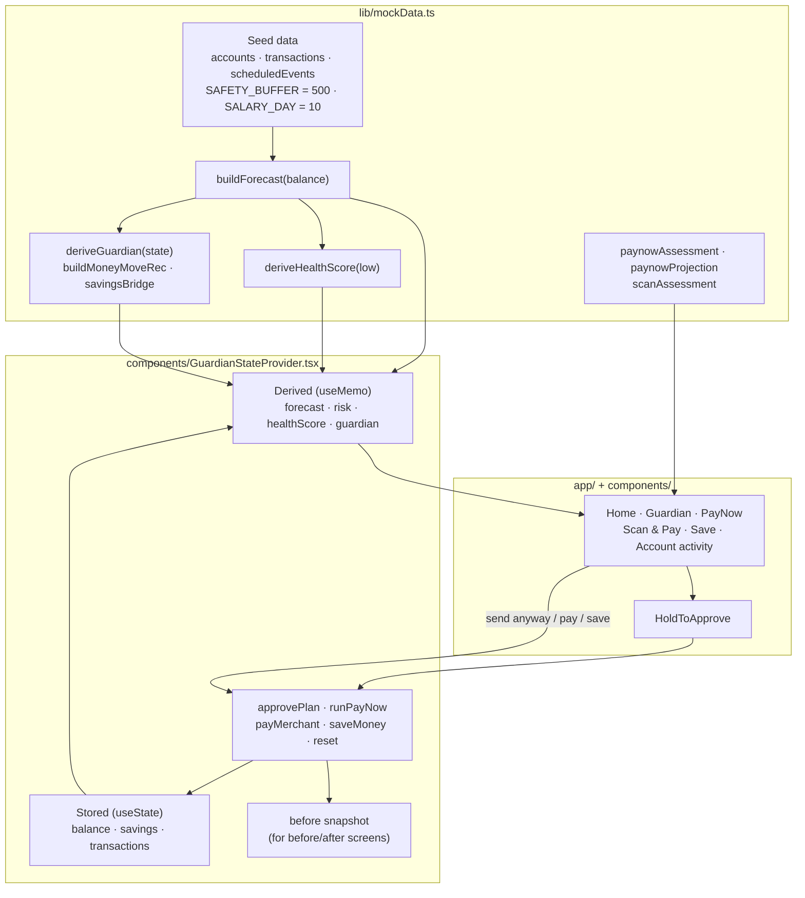

# Architecture

This document describes how the Financial Guardian prototype is built: how state flows through the app, how the forecast and risk assessments are calculated, and what the simulated actions change. For the project overview, see the [README](../README.md).

Everything described here runs in the browser. There is **no backend, database, external API or AI/ML model**; all logic is deterministic TypeScript operating on illustrative data.

## Contents

- [System overview](#system-overview)
- [State model](#state-model)
- [Decision engine](#decision-engine)
- [Simulated actions](#simulated-actions)
- [Routes](#routes)
- [UI components](#ui-components)
- [Build and deployment](#build-and-deployment)
- [Known simplifications](#known-simplifications)

## System overview

The app has three layers:

1. **Engine** — `lib/mockData.ts` holds the seed data and pure functions that turn balances into forecasts, risk levels, recommendations and payment assessments.
2. **State** — `components/GuardianStateProvider.tsx` is a React context that stores the live balances and transaction list, derives everything else from them via the engine, and exposes the simulated actions.
3. **UI** — Next.js App Router pages under `app/` and shared components under `components/` read from the context and call its actions.

`app/layout.tsx` wraps every route in `GuardianStateProvider` (and `PhoneFrame`), so state survives client-side navigation between screens. A full page reload re-creates the provider and restores the seed data.

## State model

Only three values are stored:

| Stored value | Seed | Meaning |
|--------------|------|---------|
| `balance` | SGD 2,300 | Spending (FRANK) account balance |
| `savings` | SGD 1,200 | Savings (360) account balance |
| `transactions` | 9 rows | Ledger shown on the activity screens |

Everything else is recomputed by `deriveAll(balance, savings)` whenever the balances change:

| Derived value | Source |
|---------------|--------|
| `forecast` (points, `low`, `lowDay`, `monthEnd`) | `buildForecast(balance)` |
| `healthScore` | `deriveHealthScore(forecast.low)` |
| `guardian` (status, risk, recommendations, alert, briefing copy) | `deriveGuardian({ balance, savings, low, lowDay, monthEnd })` |
| `risk` | `guardian.risk` |

Each action first captures a `before` snapshot (health score, risk, month-end, low, balances) so success screens can show before-and-after figures. Additional journey flags (`planApproved`, `lastDecision`, `lastActivity`, `pendingPayNow`, …) drive copy on the home card and success screens.

Because forecasts and assessments always read the live balances, actions **compound** within a session: for example, after a Journey A savings transfer, the same SGD 800 PayNow needs a smaller top-up, or none.

## Decision engine

All functions below live in `lib/mockData.ts`.

### Forecast — `buildForecast(balance)`

1. Start at today's `balance` (day 0).
2. Apply the seven `scheduledEvents` in day order, recording the running balance after each:

   | Day | Event | Amount (SGD) |
   |-----|-------|-------------:|
   | 1 | Spotify | −15.80 |
   | 2 | ChatGPT Plus | −28.00 |
   | 4 | NTUC FairPrice | −86.40 |
   | 5 | Insurance premium | −200.00 |
   | 7 | Rental deposit | −1,400.00 |
   | 9 | SP Utilities | −85.60 |
   | 10 | Salary credit | +4,500.00 |

3. Add a fixed `REST_OF_MONTH` adjustment (−SGD 1,884.20) to reach the day-30 month-end figure. This constant is calibrated so the seed balance lands at exactly SGD 3,100; it shifts dollar-for-dollar with any action.
4. The **lowest balance before salary day** is the minimum over debit points before day 10. With the seed data this is **SGD 484.20 on day 9**.

### Risk and status — `deriveGuardian(...)`

| Condition on `low` | Risk | Status |
|--------------------|------|--------|
| `low ≥ 500` (cushion) | Low | healthy |
| `0 ≤ low < 500` | Medium | watch |
| `low < 0` | High | risk |

`deriveGuardian` also builds the home-screen alert, the daily briefing copy and the recommendation set from these values.

### Health score — `deriveHealthScore(low)`

A display score anchored at 92 for the seed low. Above the seed low it rises towards 96 (`92 + 4·tanh(Δ/500)`); below it, it falls linearly (`92 + Δ/90`). The result is clamped to 60–98. It is a presentation heuristic, not a credit or risk model.

### Recommendations — `buildMoneyMoveRec(...)` and behavioural recommendations

- **Money move (r1)**, only when `low < 500`. The target floor is the cushion plus about one week of typical spending (`500 + round(2,420 / 4) = 1,105`). The ideal transfer is `roundUpTo100(1,105 − low)`, which is **SGD 700** for the seed data. It is then capped by `savingsBridge` at the available savings. If savings can't lift the low above the cushion, the copy switches to an honest "top up what you can" variant.
- **Ease off fun spending (r2)** and **hold the investment top-up (r3)** are fixed behavioural suggestions based on the illustrative 18% overspend figure.
- Each recommendation carries `before`/`after`, `why` and `ifIgnored` text. The risk-reduction percentages are fixed illustrative values; `combinedRiskReduction` compounds the selected ones (`1 − Π(1 − rᵢ)`).
- `planConfidence(lowAfter)` produces the "% sure" figure from a fixed data-completeness constant (0.94) plus the margin above the cushion, clamped to 80–98.

### Savings cap — `savingsBridge(needed, savingsAvailable)`

Returns `moved = min(needed, savingsAvailable)` and any remaining `shortfall`. Every money-move path uses it, so the engine can never propose moving more than the savings balance.

### PayNow pre-transaction assessment — `paynowAssessment(...)`

`paynowProjection` computes the position if the payment is sent:

- `lowIfSent = low − amount`
- `neededTopUp = roundUpTo100(500 − lowIfSent)`, capped by `savingsBridge`
- `lowAfterPlan = lowIfSent + moveFromSavings`

`paynowAssessment` then grades the outcome rather than the payment size:

| Tier | Rule (checked in order) | Intervenes? |
|------|-------------------------|:-----------:|
| `clear` | `lowIfSent ≥ 500` | No |
| `shortfall` | `lowIfSent < 0` and savings can't cover the top-up | Yes |
| `drawdown` | balance left today `< 500` | Yes |
| `protect` | `lowIfSent < 0`, or the top-up needs ≥ 40% of savings | Yes |
| `steady` | otherwise (a shallow, absorbable dip) | No |

For the demo's SGD 800 transfer: `lowIfSent = −315.80` → top-up **SGD 900** (within SGD 1,200 savings) → tier `protect` → the intervention sheet is shown. The sheet always offers *See my plan*, *Change amount* and *Send anyway*.

### Scan & Pay and Save checks

- `scanAssessment(amount, balance, low)` returns `caution` if the balance left today is below 500 or the low goes negative, `note` if the balance left is below 1,000, and `ok` otherwise. It never blocks payment.
- The Save review (`app/save/page.tsx`) flags the move as tight if `low − amount < 500`, but still allows it.

## Simulated actions

All actions are defined in `GuardianStateProvider` and only change in-memory state.

| Action | Triggered from | Balance / savings change | Ledger rows added |
|--------|----------------|--------------------------|-------------------|
| `approvePlan(selectedIds)` | `/guardian/actions` (hold to approve) | If r1 is selected: savings −X, balance +X (X = engine transfer, capped) | "Transfer from OCBC 360" |
| `runPayNow("approve", amount)` | `/paynow/plan` (hold to send) | savings −top-up; balance +top-up −amount | "Transfer from OCBC 360", "PayNow · recipient" |
| `runPayNow("proceed", amount)` | Review with no intervention, *Send anyway*, or *send without the plan* | balance −amount | "PayNow · recipient" |
| `payMerchant(merchant, amount)` | `/scan` | balance −amount | merchant row ("Scan & Pay") |
| `saveMoney(amount)` | `/save` | balance −X, savings +X (X capped at balance) | "Transfer to OCBC 360" |
| `reset()` | — | restores seed state | restores seed ledger |

## Routes

| Route | Purpose |
|-------|---------|
| `/` | Simulated banking home screen with balances and the Guardian card |
| `/guardian` | Daily briefing (with skippable reasoning animation) |
| `/guardian/overview` | Full analysis: health status, upcoming payments, life-event signal |
| `/guardian/cashflow` | 30-day forecast chart, spending analysis and timeline |
| `/guardian/actions` | Selectable recommendations with live combined risk reduction |
| `/guardian/success` | Plan outcome, before vs after |
| `/paynow` | Amount → review → pre-transaction assessment / intervention sheet |
| `/paynow/plan` | Savings-bridge plan with hold-to-send |
| `/paynow/success` | Transfer outcome, before vs after |
| `/scan`, `/scan/success` | Mock QR Scan & Pay and outcome |
| `/save`, `/save/success` | Move to savings and outcome |
| `/account/frank`, `/account/savings` | Account activity ledgers |

All routes are statically prerendered by `next build`; interactivity is client-side.

## UI components

| Component | Role |
|-----------|------|
| `PhoneFrame` | Centres the app in a 430 px phone frame on desktop; full-screen on mobile |
| `AppHeader`, `BottomNav`, `SectionCard`, `PrimaryButton`, `Keypad`, `PageTransition` | Shared layout and controls |
| `GuardianCard` | Home-screen card with alert, healthy and post-approval states |
| `CashflowChart` | Hand-built SVG chart of the forecast against the cushion |
| `HealthScoreRing` | Animated score/percentage ring |
| `RecommendationBody`, `WhyThis` | Recommendation detail and expandable explanations |
| `HoldToApprove` | Press-and-hold consent control (pointer events; ~1 s hold) |
| `GuardianSequence` | `GuardianThinking` / `GuardianExecution`: timed, skippable presentation animations stepping through fixed labels |
| `LearningNote` | Post-action note (presentational copy only) |
| `AccountActivity` | Ledger grouped by date for either account |
| `FakeQR` | Decorative, non-scannable QR graphic |
| `ConfirmationModal` | Generic confirmation dialog (not currently used by any route) |

## Build and deployment

- `next.config.js` sets `output: "standalone"` for a self-contained server build, used by the multi-stage `Dockerfile` (`node:20-alpine`, runs as a non-root user on port 3000).
- `npm start` (`next start`) still serves the build locally but logs a warning that standalone output is intended for `node .next/standalone/server.js`.
- The public demo is deployed on Vercel.
- No environment variables are read by the application.

## Known simplifications

- Single fixed customer profile, scheduled-event list, salary and cushion.
- Un-itemised spending is a single month-end constant, so the forecast's shape only changes through the starting balance.
- The briefing date, life-event confidence ("87% sure"), spending-overspend figure and behavioural risk reductions are fixed illustrative values.
- No persistence: a reload resets all state.
- No automated tests or lint configuration.
